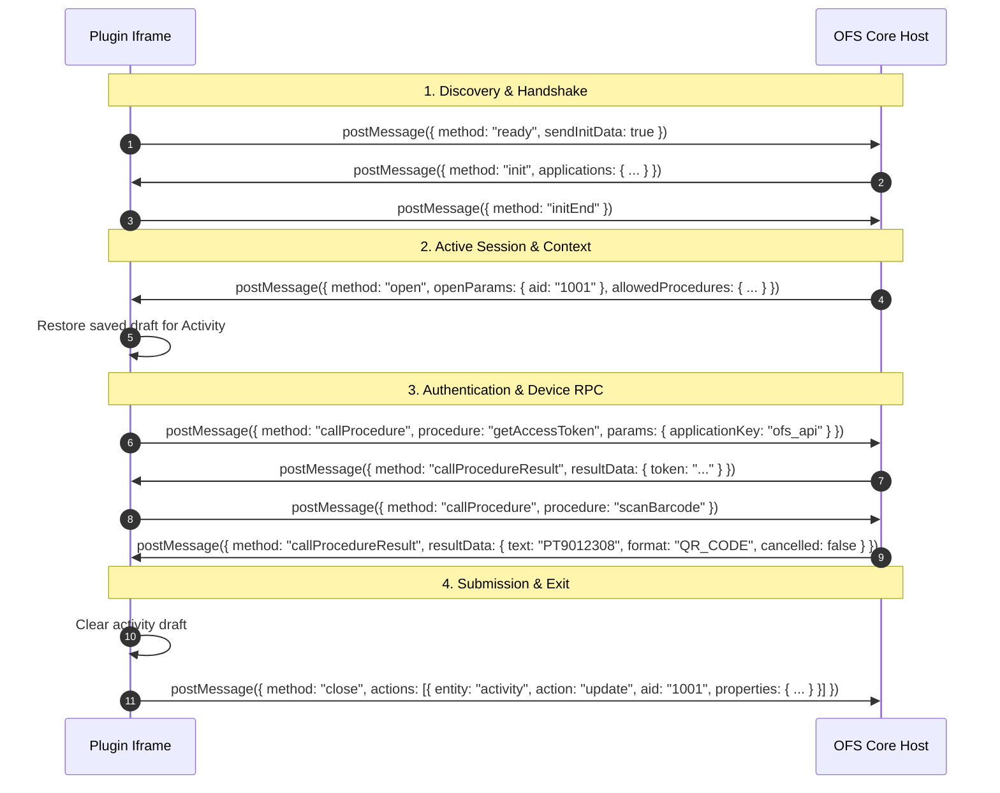

# Oracle Fusion Field Service (OFS) Plugin Template

**Enterprise Developer Reference Architecture & Starter Kit**

[](https://docs.oracle.com/en/cloud/saas/field-service/)
[](https://www.oracle.com/redwood/)
[]()
[](LICENSE)

An enterprise-ready, framework-free reference template for developing custom extensions in **Oracle Fusion Field Service (OFS)**. Built on standard vanilla JavaScript (ES6+), HTML5, and CSS, it demonstrates the official plugin protocol, bidirectional `postMessage` RPC, in-memory OAuth token handling, activity-scoped drafts, and hardware device integrations without build-step overhead.

---

## 🚀 Quick Start: Deploy to Your OFSC Instance

> [!IMPORTANT]
> **Dedicated OFSC Instance Required**: Full end-to-end functionality—including native camera barcode scanning, host OAuth token generation, and activity updates—requires deploying the plugin archive directly into an Oracle Field Service environment.

### 1. Download or Build the Plugin Archive
Download the pre-packaged archive ready for upload:

[](https://github.com/saikumargudelly/oracle-field-service-plugin-template/raw/main/plugin.zip)

*(Or run `npm run package` locally to rebuild `plugin.zip` from source)*

### 2. Upload to OFSC Administration
1. Log into your Oracle Field Service environment as an administrator.
2. Navigate to **Configuration** ➡️ **Forms & Plugins**.
3. Select **Add Plugin** ➡️ **Plugin Archive** ➡️ Upload `plugin.zip`.
4. Configure the plugin properties:
   - **Name**: `Hello OFS Demo`
   - **Label**: `TEST_HELLO_OFSC` *(must match the tag passed in `plugin.init()`)*
   - **Type**: Standard Plugin (or Modal)
   - **Allowed Procedures**: Enable **`scanBarcode`**
   - **Applications**: Select your configured OAuth application(s)
5. Click **Save**.

### 3. Bind to Screen Layout
1. Navigate to **Configuration** ➡️ **User Types** ➡️ **Screen Configuration**.
2. Select your target layout (e.g. *Activity Details* or *Edit Activity*).
3. Add an action button targeting `TEST_HELLO_OFSC` and save the configuration.

### 4. Test Live in OFSC Mobility
Open any assigned activity in the OFSC Mobility application to launch and test the plugin live with real context parameters (`aid`, `resourceId`).

---

## 🏛️ Architecture & Lifecycle Contract

Oracle Field Service plugins run inside a sandboxed `<iframe>` within the OFS Core web application or native mobile clients (iOS / Android). Communication is handled via asynchronous JSON payloads over `window.postMessage`.



---

## 📂 Repository Structure

| File | Description |
| :--- | :--- |
| [`index.html`](index.html) | Plugin UI entry point featuring Redwood design components and interactive property inputs. |
| [`plugin.js`](plugin.js) | Central controller managing lifecycle events, origin checks, procedure RPC, token cache, and submissions. |
| [`localStorage.js`](localStorage.js) | Storage layer with automated in-memory fallback for third-party cookie/partitioned storage environments. |
| [`style.css`](style.css) | Oracle Redwood styling system tokens (`--primary: #c15c3d`, Canvas Cream, Charcoal). |
| [`mock-host.html`](mock-host.html) | Local development harness simulating the OFS parent window, live message inspector, and barcode cancel toggles. |
| [`package.js`](package.js) | Zero-dependency build utility generating the root-level `plugin.zip` for OFS administration upload. |

---

## 🔒 Enterprise Engineering Standards

1. **Message Source & Origin Validation**: When running inside an iframe, the plugin verifies that incoming messages originate strictly from `window.parent`, rejecting rogue messages from unexpected windows, popups, or sibling frames. It also enforces HTTPS protocol and strict hostname boundaries against trusted Oracle Cloud domains (`*.etadirect.com`, `*.oraclecloud.com`, `*.oracle.com`) and local development loopbacks, rejecting lookalike domains (e.g. `oracle.com.attacker.example`).
2. **Discovery Handshake vs. Privileged Messages**: When the plugin first boots in an iframe, `document.referrer` may be stripped by browser privacy policies before any host message has arrived. The non-sensitive initial `ready` discovery message (containing zero business data) is permitted to fall back to `targetOrigin: "*"` to initiate contact with OFS Core. Immediately upon the first verified incoming host message, the target origin is locked. All privileged messages (`initEnd`, `callProcedure` tokens, `close` entity updates) strictly require a verified target origin and are actively blocked otherwise.
3. **Documented Barcode Contract**: Implements the official Oracle `scanBarcode` procedure contract. Responses are parsed for `text`, `format`, and `cancelled`. Successful scans populate the form input strictly from `resultData.text`. If a technician cancels the scanner (`resultData.cancelled === true`), the input remains unchanged and a non-intrusive status message is displayed. Malformed responses are handled safely without serializing raw objects into the UI.
4. **XSS Protection**: All incoming parameters (`aid`, `resourceId`, application metadata) are sanitized via HTML entity encoding before rendering into the DOM.
5. **In-Memory Token Lifecycle**: OAuth tokens retrieved via `getAccessToken` are retained exclusively in volatile memory (`this._cachedTokens`). Tokens are never written to persistent browser storage or written to log files.
6. **Scoped Form Drafts**: Drafts are partitioned by unique Activity ID (`${tag}_draft_aid_${aid}`), preventing draft leakage across customer assignments. Drafts are automatically purged on submission.
7. **Procedure Timeouts**: Remote procedure calls (`callProcedure`) feature a 15-second safety timeout and rejection handling to prevent interface freezing.
8. **REST API & CORS Architecture**: Even when uploaded as a hosted plugin archive (`.zip`), OFS executes plugins inside an isolated, sandboxed `<iframe>`. Browser Same-Origin Policy strictly enforces CORS on direct `fetch()` calls to OFS Core REST endpoints. To execute direct REST calls, the plugin's origin must be allowed under *Configuration ➡️ Applications* in OFS, or routed via Oracle Integration Cloud (OIC) / API gateway. For standard entity updates (activities, inventory), plugins should use native OFS `close` action payloads, which run over `postMessage` RPC and are never blocked by CORS.

---

## 🛠️ Offline Developer Utilities (Optional)

Before uploading to an OFSC instance, you can use these optional offline utilities for preliminary syntax and protocol verification:

### Automated Unit Tests
```bash
npm test
```
Runs the 22-test Node.js native test suite (`node:test`) to verify message parsing, source window validation, XSS sanitization, origin checking, barcode handling, and activity draft scoping without external dependencies.

### Local Mock Simulator
```bash
python3 -m http.server 8080
# Open http://localhost:8080/mock-host.html
```
Launches a standalone local browser simulator (`mock-host.html`) that emulates parent window handshake events (`ready`, `init`, `open`, `close`) for offline UI and layout inspection.

---

## 📚 Technical References

- [Oracle Fusion Field Service Mobile Plugin Framework Guide](https://docs.oracle.com/en/cloud/saas/field-service/fapcf/)
- [Oracle Field Service REST API Documentation](https://docs.oracle.com/en/cloud/saas/field-service/farfs/)
- [Oracle Redwood Design System Guidelines](https://www.oracle.com/redwood/)

---

## 📄 License
This reference template is distributed under the [MIT License](LICENSE).
