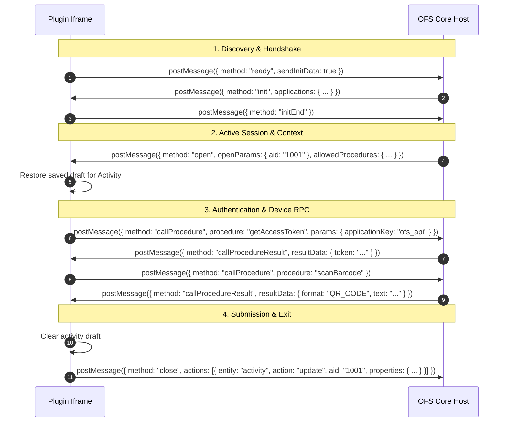

# Oracle Fusion Field Service (OFS) Plugin Template

**Enterprise Developer Reference Architecture & Starter Kit**

[](https://docs.oracle.com/en/cloud/saas/field-service/)
[](https://www.oracle.com/redwood/)
[]()
[](LICENSE)

An enterprise-ready, framework-free reference template for developing custom extensions in **Oracle Fusion Field Service (OFS)**. Built on standard vanilla JavaScript (ES6+), HTML5, and CSS, it demonstrates the official plugin protocol, bidirectional `postMessage` RPC, in-memory OAuth token handling, activity-scoped drafts, and hardware device integrations without build-step overhead.

---

## ⚡ Quick Start

### 1. Download Deployable Plugin Archive
Download the pre-packaged archive directly to your local **Downloads** folder:

[](https://github.com/saikumargudelly/oracle-field-service-plugin-template/raw/main/plugin.zip)

- **Direct Download**: [**Download plugin.zip**](https://github.com/saikumargudelly/oracle-field-service-plugin-template/raw/main/plugin.zip)
- **Local Generation**: Run `npm run package` (or `node package.js`) to rebuild `plugin.zip` from source.

### 2. Local Simulation & Verification
Test the entire plugin lifecycle locally without an active Oracle Cloud tenant:
```bash
# Start a local static server
python3 -m http.server 8080

# Open the interactive mock host in your browser:
# http://localhost:8080/mock-host.html
```

### 3. Run Automated Unit Tests
Verify protocol handling, security sanitization, and storage resilience:
```bash
npm test
```

---

## 🏛️ Architecture & Lifecycle Contract

Oracle Field Service plugins run inside a sandboxed `<iframe>` within the OFS Core web application or native mobile clients (iOS / Android). Communication is handled via asynchronous JSON payloads over `window.postMessage`.



---

## 📂 Repository Structure

| File | Description |
| :--- | :--- |
| [`index.html`](index.html) | Plugin UI entry point featuring Redwood design components and interactive property inputs. |
| [`plugin.js`](plugin.js) | Central controller managing lifecycle events, origin checks, procedure RPC, token cache, and submissions. |
| [`localStorage.js`](localStorage.js) | Storage layer with automated in-memory fallback for third-party cookie/partitioned storage environments. |
| [`style.css`](style.css) | Oracle Redwood styling system tokens (`--primary: #c15c3d`, Canvas Cream, Charcoal). |
| [`mock-host.html`](mock-host.html) | Local development harness simulating the OFS parent window and live messaging inspector. |
| [`package.js`](package.js) | Zero-dependency build utility generating the root-level `plugin.zip` for OFS administration upload. |

---

## 🔒 Enterprise Engineering Standards

1. **Strict Message Origin Validation**: Enforces parent window origin verification using `document.referrer` and `window.location.ancestorOrigins`. Eliminates wildcard target origins for privileged data transfers.
2. **XSS Protection**: All incoming parameters (`aid`, `resourceId`, application metadata) are sanitized via HTML entity encoding before rendering into the DOM.
3. **In-Memory Token Lifecycle**: OAuth tokens retrieved via `getAccessToken` are retained exclusively in volatile memory (`this._cachedTokens`). Tokens are never written to persistent browser storage or written to log files.
4. **Scoped Form Drafts**: Drafts are partitioned by unique Activity ID (`${tag}_draft_aid_${aid}`), preventing draft leakage across customer assignments. Drafts are automatically purged on submission.
5. **Procedure Timeouts**: Remote procedure calls (`callProcedure`) feature a 15-second safety timeout and rejection handling to prevent interface freezing.

---

## 🚀 Deployment Guide

1. **Package the Archive**:
   ```bash
   npm run package
   ```
   *(Verifies `index.html` is packaged at the archive root of `plugin.zip`)*.

2. **Register in OFS Administration**:
   - Navigate to **Configuration** ➡️ **Forms & Plugins**.
   - Select **Add Plugin** ➡️ **Plugin Archive** ➡️ Upload `plugin.zip`.
   - **Label**: `TEST_HELLO_OFSC` *(must match label configured in `plugin.init()`)*.
   - **Allowed Procedures**: Select **`scanBarcode`** (and native procedures as required).
   - **Applications**: Associate target OAuth applications for token retrieval.

3. **Bind to Screen Layout**:
   - Navigate to **Configuration** ➡️ **User Types** ➡️ **Screen Configuration**.
   - Open target layout (e.g. *Activity Details*), insert an Action button targeting `TEST_HELLO_OFSC`.

---

## 📚 Technical References

- [Oracle Fusion Field Service Mobile Plugin Framework Guide](https://docs.oracle.com/en/cloud/saas/field-service/fapcf/)
- [Oracle Field Service REST API Documentation](https://docs.oracle.com/en/cloud/saas/field-service/farfs/)
- [Oracle Redwood Design System Guidelines](https://www.oracle.com/redwood/)

---

## 📄 License
This reference template is distributed under the [MIT License](LICENSE).
